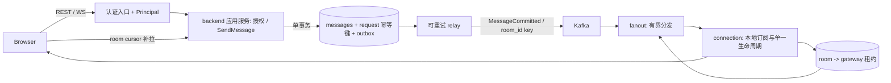

# 架构审计：2026-10-27

审计基线：`08c2f3a`。范围为三个 Go 服务、前端、Python 检索服务及部署/CI。方法为实际入口追踪、源码审阅、内存 SQLite / 本机 HTTP 和 WS / Go overlay / race detector / 当前 TS reducer 的隔离验证。未修改业务实现，未连接真实 Redis/Kafka，未部署或执行压测。

> 整改注记（2026-10-28）：本报告保留 `08c2f3a` 的历史证据；当前 A02/A03/A04 已本地修复，A01 已落实已定义边界；后续 N1/N2 补内部 fanout 服务鉴权与本机 HTTP→WS 回归，N3 按用户选择实施创建者删除和未知旧归属拒删，未决权限与实际验证见 [实施计划](remediation-plan.md)、[ADR](decisions/0001-identity-and-room-authorization.md)。

## 结论

backend / connection / fanout 的职责划分可以保留。当前主要障碍是身份与授权没有贯穿业务调用、消息提交与投递缺少一致性协议、presence 的所有权无法覆盖多实例，以及 UI 没有恢复/去重协议。这些问题已经影响单实例正确性；只增加副本或替换框架不能解决。

建议先修复身份与数据暴露，再统一消息写入和确认，随后重做路由租约与连接生命周期，最后完善部署及性能验证。下面给出源码事实、复现结果和建议目标，建议目标均尚未实现。

优先级：P0 为对外开放前应消除的数据/身份缺陷；P1 为消息正确性、恢复和扩容问题；P2 为性能与维护优化。优先级不表示已确认线上部署或真实数据受影响。

## 主要发现

### A01 · P0：认证结果没有成为业务身份，REST 与 WS 都存在越权路径

证据：[REST middleware](../backend/internal/middleware/jwtauth/session_auth.go#L34) 丢弃 ValidateJWT 返回的 User/Session；[消息 controller](../backend/internal/controller/message_controller.go#L33) 直接信任 body.user_id，查询与删除也没有调用者参数。[WS chain](../connection/cmd/server/main.go#L181) 没有使用传入的 JWT middleware；[groupAssignmentHandler](../connection/cmd/server/main.go#L87) 直接使用事件 UserId，join 不检查永久成员关系。

复现：用 Alice 的真实有效 token，成功以 Bob 的 user_id 创建消息、读取未加入房间的历史并删除 Bob 的消息。匿名 WS 握手返回 101，并成功加入任意指定房间。这些探针使用当前实际 middleware/service 和本机 WS handler。

优化：REST/WS 入口生成统一 Principal（不可变 user_id、session_id、权限信息），业务方法显式接收 Principal；发送、读历史、删除、订阅均检查对应授权。用户 ID 从身份派生，不能由事件反复改写。WS 应在 upgrade 前验证握手凭据，或设计首帧认证和严格认证超时；浏览器 token 传递方式需一起设计。只把现有 middleware 加回 chain 仍不解决房间授权与身份绑定。

验收：Alice 不能冒用 Bob，非成员不能读/订阅受限房间；失效 session 不能继续发送；匿名连接不能得到业务订阅权限。若产品允许公共历史/房间，必须显式定义该策略，用户冒用与无权限删除仍应禁止。

### A02 · P0：数据库 User 同时承担输入与输出 DTO，暴露密码并绕开统一密码处理

证据：[User.Password](../backend/internal/model/user.go#L12) 是可序列化字段；[GetUsers](../backend/internal/controller/user_controller.go#L43) 直接返回 repo 查询结果；[CreateUser](../backend/internal/service/user_service.go#L25) 不哈希密码便写 repo，而公开注册 handler 又单独负责哈希。

复现：普通用户的 GET /users 响应包含另一用户的密码哈希。POST /users 的未哈希写入风险由完整 controller → service → repo 路径确认。

优化：使用独立 Register/CreateUserRequest 与 UserResponse；密码哈希仅在统一应用服务执行，持久模型密码字段不直接序列化。明确创建用户接口是否需要管理权限。开发固定 JWT 密钥改为可注入配置，移除客户端 token 日志；不是仅修改 omitempty。

验收：任何用户响应都不包含 password/hash/session secret；所有创建入口使用相同密码策略；敏感字段不能由通用模型绑定绕过规则。

### A03 · P0：失败登录也会撤销该账号的全部现有会话

证据：[AuthController.Login](../backend/internal/controller/auth_controller.go#L56) 在调用校验密码的 Service.Login 之前执行 ForceLogoutAll。

复现：已有有效会话的用户收到一次错误密码登录后，原 token 的 ValidateJWT 从成功变为 session invalid/revoked。请求方不需要知道正确密码。

优化：把登录校验、会话创建和单会话/多会话策略放进 AuthService；先验证凭据，再按明确策略原子更新会话。撤销失败不可仅日志后继续；刷新、撤销与 WS 踢出需要统一传播。FindValidSession 还应核对 session ExpiresAt（当前只查 revoked；JWT 自身过期仍会被解析校验，不能把该缺口描述为已绕过 JWT exp）。

验收：错误密码不改变任何有效会话；并发成功登录符合既定会话策略；过期、撤销和 WS 生命周期有覆盖。

### A04 · P0：backend 启动拥有清空共享路由状态的副作用

证据：[backend main](../backend/cmd/main.go#L27) 在 Redis 初始化错误检查前执行 ClearRedis；[实现](../backend/internal/redisdb/redis.go#L44) 是 FLUSHDB。同一 Redis DB 存有 gateway presence 和 backend 缓存。

影响：一次 backend 重启会删除其他服务的在线路由；恢复取决于后续 presence 刷新，并可能丢掉期间通知。Redis 不可用时还可能先使用空 client。

优化：移除正常启动重置，数据重置作为显式开发命令。缓存与路由使用清晰命名空间和最小权限；缓存失效只能作用于本服务拥有的 key。错误检查先于任何后续使用。

验收：backend 重启不改变在线 gateway/room 状态；依赖失败可控退出且不 panic；开发重置无法误作用于其他状态域。

### A05 · P1：消息写库和发事件不是一个可靠的业务提交

证据：[KafkaService](../backend/internal/service/kafka_service.go#L42) 写库错误仅打印，随后仍发布；发布错误在上层被忽略；[consumer](../backend/internal/kafka/consumer.go#L78) 无 handler error 返回并标记消息。Message 模型没有请求幂等键，[REST create](../backend/internal/controller/message_controller.go#L33) 又是只写库的独立路径。

复现：写库失败仍产生 notification；完全相同的 temp_id / event id 调用两次产生两条数据库消息；出站事件保留客户端 ID，和 Message.ID 不一致。

优化：REST 和 Kafka command consumer 共用 SendMessage 应用用例。事务中写 messages 与 outbox，唯一约束 user_id + client_request_id，返回已提交 server_message_id、room_seq 和统一时间。relay 发布失败可重试；consumer 在持久提交/明确持久处理结果后推进 offset。relay 崩溃可导致重复事件，仍须 event_id 去重。Kafka 对外部存储的一致性需要额外协调，不能由 acks=all 自动推导。[Kafka 3.8 交付语义](https://kafka.apache.org/38/design/design/#message-delivery-semantics)

验收：提交前失败不广播；提交后 broker 不可用仍可恢复发布；重试只产生一条业务消息；REST 与 WS 的最终行为一致。

### A06 · P1：端到端确认缺失，HTTP/Kafka 成功与客户端已收到混为一谈

证据：[fanout consumer](../fanout/internal/kafka/consumer.go#L75) 在 handler 失败后仍 MarkMessage；[gateway async queue](../connection/internal/sink/async_sink.go#L77) 保存连接 context，失败仅 OnWriteError 日志；[HTTP fanout](../connection/internal/source/http_source.go#L100) 在广播尝试后返回 204，没有逐客户端 ACK。

复现：模拟 gateway 不可用，fanout 仍标记消息可提交。当前 HTTP 成功不能证明所有 send channel 接收成功，更不能证明浏览器消费。

优化：明确 accepted / persisted / delivered 的含义；客户端至少获得持久化 ACK 和可重试 request_id。若通知通道定位为可丢的在线提示，就以持久历史 + room cursor 补拉保证恢复，不必无限重试每个离线客户端；若承诺可靠推送，则需持久重试/死信、局部成功记录和客户端 ACK。已接纳命令的生命周期不应无意随 WS 断开取消。

验收：关闭浏览器、Kafka 超时、网关 500、部分网关成功都产生明确状态；恢复可补齐，重发不会重复业务消息。

### A07 · P1：没有房间顺序模型，Kafka 多分区扩容后语义不稳定

证据：[gateway producer](../connection/internal/adapter/kafka/event_sink.go#L61) 不设置 key；[backend 发布](../backend/internal/service/kafka_service.go#L75) 传 nil key；[历史查询](../backend/internal/repo/message_repo.go#L44) 用 id 作游标却只按 created_at 排序。

影响：当前单分区开发环境可能掩盖顺序问题；多分区时同一房间可能被不同 consumer 并行处理。即使没有跨分区，created_at 相同也缺稳定次序。现有并未观察到生产乱序，本项是由代码确认的缺少保证。

优化：明确每房间 room_seq，使用 room_id 分区键；同一房间的序列在持久化事务中分配。分页、重放和客户端去重基于明确游标，排序字段与游标一致。key 只保证进入同一分区的前提，不自动给跨 producer 的并发请求定义业务总序。[Kafka 分区设计](https://kafka.apache.org/38/design/design/)

验收：多 partition、多 producer、consumer 重启和同时间戳数据下，历史不漏不重，实时与历史可按 room_seq 对齐。

### A08 · P1：presence 是单用户单值映射，不能表达多网关所有权

证据：[SetUserGateway/RemoveUserGateway](../connection/internal/registry/redis_registry.go#L50) 无条件 SET/DEL；房间 TTL 作用于整个 Set；[显式 leave](../connection/cmd/server/main.go#L103) 不检查同用户其他连接，本地断线检查也无法观察别的网关。[worker](../fanout/internal/fanout/dispatcher.go#L43) 每条消息先枚举所有用户，再查 gateway。

复现：同网关两个标签页仍有一个订阅时，另一个发送 leave 会立即删除 Redis room user。多网关覆盖/误删与集合 TTL 问题由源码确认：活跃成员刷新整个集合，会保留故障成员；同用户不同网关相互覆盖，旧网关可删除新归属。

优化：针对当前房间广播语义，优先使用 room → gateway 实例租约；gateway 本地管理 user/connection/group 索引。离开最后一个本地订阅才撤销本实例租约；用实例 incarnation/所有权条件避免旧进程删新状态。另有用户定向需求时才设计 user → 多连接/多 gateway 索引。

这会把房间广播的 Redis 查询从按人数枚举改为按所在网关枚举，但吞吐收益仍需测量。租约重建、故障过期和原子更新必须一起设计，不能只把字符串改 Set。

验收：同用户多标签/多网关都收到消息，关闭一个不影响其余；旧实例退出不删除新实例租约；故障成员能独立过期。

### A09 · P1：连接状态没有单一同步和退出边界，已有真实 race

证据：[MemoryStore](../connection/internal/gateway/connection_store.go#L56) 在锁内改 Client.UserID，却把可变 Client 指针返回；[HasClientForUser](../connection/internal/gateway/hub.go#L116)、presence refresher 在锁外读取。慢客户端处理先 [RemoveClient](../connection/internal/gateway/hub.go#L206)，随后 readPump 再取断线 metadata；writePump 写错误直接返回，没有主动完成连接清理。

复现：race detector 在 HasClientForUser 与 SetClientUserID 之间报告 DATA RACE；慢客户端被驱逐后，RemoveClientAndGroups 得到 user=0、groups=[]，Redis 清理丢失所需身份信息。

优化：连接身份认证后不可变；store 对外返回快照或提供在锁内完成的业务查询，不暴露可变字段读写。统一 Hub.Disconnect(reason)：原子摘除并保留 metadata，关闭 IO、更新本地索引，再在锁外更新 registry。read/write/慢客户端/服务关闭均走同一出口；以所有权条件处理并发重连。

额外需要信号驱动 draining 和有截止时间的队列关闭。当前 server.ListenAndServe → log.Fatal 不执行正常 defer 清理；仅加 HTTP Shutdown 也不会关闭升级后的 WS，须显式管理长连接。[Go HTTP Shutdown](https://pkg.go.dev/net/http#Server.Shutdown)

验收：针对身份查询、广播/关闭、驱逐、重连、SIGTERM 的 race 测试通过，presence 清理执行一次且保留其他连接。

### A10 · P1：客户端消息状态与恢复协议尚未闭合

证据：[CONFIRM reducer](../frontend/src/hooks/useMessages.tsx#L20) 只替换已有 TempID；[ChatRoom](../frontend/src/components/chatroom/ChatRoom.tsx#L33) 对所有 message 都调用 confirm；[onopen](../frontend/src/hooks/useChatSocket.tsx#L42) 不恢复订阅；send 在 socket 未 OPEN 时直接返回，而 UI 仍追加 pending。

复现：执行当前 reducer，空消息列表收到远端 CONFIRM 后仍为空。重连/发送时机问题由调用路径确认，未运行浏览器端到端实验。

优化：按 server_message_id / client_request_id upsert，并检查 room_id；pending 与已提交消息使用不同状态。维护期望订阅集合，OPEN 后恢复并按 last_seen_room_seq 补拉；send 返回明确接受/拒绝/待重试状态。历史请求切换房间时取消或忽略旧响应，避免晚到的 LOAD 覆盖新房间或实时消息。

验收：两用户互发、多次重复回流、先实时后历史、断线补拉、切换房间和未 OPEN 发送均有覆盖。

### A11 · P1：相同的 1 MiB 限制跨编码不等价，会产生正常入站后静默丢弃

证据：[WS read limit](../connection/internal/gateway/connection.go#L128)、[fanout JSON 读取](../connection/internal/source/http_source.go#L75)、[JSON payload](../fanout/internal/fanout/dispatcher.go#L80)。bytes 在 JSON 中为 base64，还有 user_ids 等 envelope 开销。

复现：819217 字节的 WS protobuf 未超过入站限制，转为 1092366 字节 HTTP JSON 后被 fanout 返回 400 invalid json；结合 A06，该事件随后仍可能被提交消费 offset。

优化：定义 content bytes 与每跳 envelope 的统一预算，在入口拒绝超限；内部限制覆盖 base64 和路由列表开销，返回明确 413。若继续 HTTP，可统一内部二进制编码或限制/分批目标集合；无须仅为此迁移 RPC 框架。

验收：边界尺寸和大量接收者在整条链路中可预测地成功或入口失败，不能持久化后才因内部编码膨胀丢通知。

### A12 · P1：目前部署拓扑与本地存储不支持直接增加 backend/gateway 副本

证据：[kind kustomization](../deploy/k8s/base/kustomization.yaml) 没有 fanout；[connection Service](../deploy/k8s/base/connection.yaml#L46) 只暴露 8081；[backend Deployment](../deploy/k8s/base/backend.yaml) 无 SQLite 持久卷；[DB 初始化](../backend/internal/app/db.go#L21) 仅支持本地 SQLite。Compose 的 Kafka 目录在容器 /tmp 且未挂载数据卷。readiness 只是 TCP。

影响：多 backend 实例会各有不同的用户/session/历史数据库；Pod 重建可丢数据。增加 gateway replicas 也没有具体实例寻址与正确租约。当前清单适合实验，不能据此宣布支持水平扩容。

优化：先明确单实例演示与可扩容部署两种目标。前者保留 SQLite 并持久化，明确单 writer；后者先落共享数据库（例如 PostgreSQL）、可追踪迁移与连接预算，再修 gateway 实例路由、补 fanout 镜像/Deployment、存储与 readiness/draining。切换数据库是迁移工程，不是改 dialect 字符串。

验收：新 clone 可构建完整拓扑，Pod 重建保留业务数据；两个 backend 看到一致用户/session/消息；两个 gateway 跨实例收发；滚动升级可恢复。

### A13 · P2：性能保护与存储访问的实际约束和配置意图不一致

证据：[LoadShedding](../backend/internal/middleware/loadshedding/load_shedding.go#L15) 在拿 worker 前先占 queue，且 handler 结束才释放 queue。`maxConcurrent=20,maxQueue=5` 的实际同时在途数最多 5。[dispatcher](../fanout/internal/fanout/dispatcher.go#L66) 逐网关串行 HTTP，单请求超时 3s。[MemoryStore](../connection/internal/gateway/connection_store.go#L40) 断线扫描所有房间。[Message](../backend/internal/model/message.go) 没有房间分页复合索引；历史默认可无限读取、limit 也无上限。

复现：5 个已进入 handler 的请求阻塞时，第 6 个立即收到 503，虽然配置允许 20 个并发。串行 fanout、查询与扫描的实际容量尚未压测，不能由代码推出 QPS 上限。

优化：将 active 与 pending 令牌生命周期分开，加入 context/timeout；fanout 使用有界并发与每 gateway 隔离，保留每房间事件顺序；本地加 connection→rooms、user→connections 索引并清空房间对象；历史设置默认/最大页长，索引与游标顺序一致并检查 EXPLAIN。Kafka sink 的单 worker /1024 全局队列需要观测后再调，不直接无限增并发。

验收：active/pending 数符合配置；慢网关不拖延健康网关；边界内存/队列有指标；真实负载测试给出吞吐、p95/p99、丢失/重复数与 consumer lag。

## 其他维护建议

- **装配与业务边界**：[SetupRouter](../backend/internal/routes/routes.go#L149) 同时建立真实 Kafka 并启动后台 consumer，导致 router 构建和 HTTP 可用性与 broker 强耦合。拆成 App.Start/Run/Close、纯路由装配和可独立启动的 worker；复用同一个应用服务，不必增加新部署服务。
- **协议语义**：KafkaEvent 同时承担客户端命令和已提交事件，ID 与时间单位不一致。分清 SendMessageCommand / MessageCommitted / DeliveryEnvelope；保留现有 schema 兼容字段，不直接复用 field number。可以继续用 Protobuf，先修语义。
- **可观测性**：增加 request_id、event_id、message_id、room_seq 关联日志；采集持久化延迟、outbox backlog、Kafka lag、fanout 失败、队列深度、在线/丢弃连接及恢复补拉指标。移除原始消息/令牌打印。先有指标再判断锁分片、批量发送或协议迁移。
- **配置/上下文**：统一 typed config、启动校验与依赖注入；DB repo 接收 context 并向下传播取消/超时。JWT 密钥、地址、origin、请求上限不可散落在源码；保持独立 go.mod 不影响这些改进。
- **Python**：[storage](../python_ai_service/app/storage.py#L59) 先修改内存再重建和直接覆盖文件，失败可导致内存/文件不一致；单进程锁不能协调多 worker。当前独立实验服务可保留；接入聊天检索前必须定义数据来源、事件同步、房间可见性、原子写/重建策略及测试，暂不把它放进同步发送关键路径。未运行 Python，因为本环境缺 sklearn。

## 建议目标架构（尚未实现）



入口到应用服务可以暂时保留现有 user-request topic：WS command → Kafka → backend 的同一用例。REST 直接调用该用例。是否缩短入站路径需根据实际延迟/SLO 决定，不能先假定两跳 Kafka 都必要或都应删除。使用 outbox 不要求立即部署 Debezium；当前可先实现数据库轮询 relay，后续需要 CDC 时再评估。事件唯一 ID 与 aggregate key 是可参考的成熟协议元素。[Debezium outbox 协议](https://debezium.io/documentation/reference/stable/transformations/outbox-event-router.html)

各模块的建议所有权：backend 拥有身份策略、业务授权与持久事实；connection 拥有本实例连接与订阅；fanout 拥有投递调度；Redis 拥有可重建租约状态；Kafka 传已定义语义的命令/事件；客户端拥有可恢复视图。不要让任何服务启动时清理其他模块状态。

## 落地顺序与验收关卡

| 阶段 | 内容 | 完成关卡 |
| --- | --- | --- |
| 1 身份与数据边界 | A01–A04：Principal/授权、DTO/密码、登录副作用、移除 FLUSHDB | 越权和错误密码回归变成安全预期；重启不清共享状态 |
| 2 持久化与协议 | A05–A07、A11：统一用例、请求幂等、outbox、ACK、顺序与尺寸 | DB/Kafka 故障和重复请求下不丢持久事实、不重复业务消息 |
| 3 连接与恢复 | A08–A10：gateway 租约、并发/退出边界、UI upsert/重连补拉 | 多标签/多网关与 race/断线重连测试通过 |
| 4 部署与容量 | A12–A13：完整拓扑、持久化、readiness、指标、负载保护 | 两个 backend/两个 gateway 一致收发、Pod 重启与故障演练、容量报告 |

当前没有用户规模、消息速率、p95/p99 目标或真实负载指标。本报告不声称 Redis/Kafka/SQLite 已达到容量瓶颈，也不建议先引入更多微服务、服务网格或更换前端框架。若项目长期只做单实例演示，可简化部署；若目标是学习分布式/多网关，则保留当前服务分工并依序补齐上述协议。

## 复现与验证记录

临时探针位于 `/tmp/chords-architecture-audit/`，通过 Go overlay 挂载额外测试，不写应用源文件。11 个 Go 普通复现场景成功确认当前行为，1 个 TS reducer 场景确认远端消息遗漏，1 个 race 探针预期返回非零并报告实际生产函数竞争。这里的“PASS”表示缺陷被重现，不表示实现符合安全/正确性要求。

| 探针 | 观察结果 |
| --- | --- |
| WrongPasswordRevokesExistingSession | 错误密码后原有效 session 被撤销 |
| AuthenticatedUserCanForgeReadAndDeleteOtherUsersMessage | Alice token 可冒用 Bob、读未加入房间、删除消息 |
| UserListIncludesPasswordHashes | GET /users 包含其他用户哈希 |
| StorageFailureStillPublishesNotification | 写库失败仍发布 |
| DuplicateRequestCreatesTwoRowsAndKeepsClientID | 相同请求两条记录、事件 ID 非数据库 ID |
| AnonymousWebSocketCanJoinAnyRoom | 无 token 握手 101 并订阅指定 room |
| ExplicitLeaveDeletesPresenceWhileAnotherTabRemains | 第二标签仍订阅，Redis room user 仍被移除 |
| SlowClientEvictionErasesDisconnectMetadata | 驱逐后断线 metadata 为空 |
| FailedDispatchStillMarksConsumedMessage | handler 失败后 MarkMessage 仍执行 |
| QueueLimitAlsoCapsActiveRequests | 5 个 active 时第 6 个被拒，20 并发配置未生效 |
| WSSizeAndFanoutJSONLimitConflict | 819217-byte protobuf → 1092366-byte JSON → 400 |
| 当前 CONFIRM reducer | 空列表收远端消息后仍为空 |
| PresenceUserIDRace（-race） | hub.go:117 的 HasClientForUser 读与 connection_store.go:60 写竞争 |

运行方式（临时目录在本次会话中存在；后续修复应把对应场景转成常驻的安全/正确行为回归测试）：

```bash
cd backend
go test -overlay=/tmp/chords-architecture-audit/backend-overlay.json ./internal/controller ./internal/service ./internal/middleware/loadshedding -run '^TestAudit' -v
```

```bash
cd connection
go test -overlay=/tmp/chords-architecture-audit/connection-overlay.json ./cmd/server ./internal/gateway ./internal/source -run '^TestAudit(Anonymous|Explicit|Slow|WSSize)' -v
go test -race -overlay=/tmp/chords-architecture-audit/connection-overlay.json ./internal/gateway -run '^TestAuditPresenceUserIDRace$' -count=1
```

```bash
cd fanout
go test -overlay=/tmp/chords-architecture-audit/fanout-overlay.json ./internal/kafka -run '^TestAudit' -v
```

真实 Kafka/Redis、浏览器端到端、Pod 滚动升级和压力/故障环境未执行。跨实例问题标注为源码确认的结构缺陷，没有伪装成已运行的多 Pod 实验。没有执行依赖升级、漏洞数据库扫描或生产渗透测试；本报告是应用架构及关键正确性审计。
