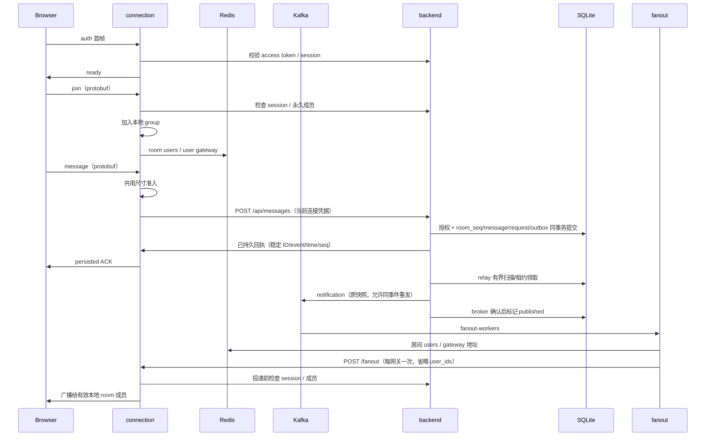

# 架构与实际数据流

## 服务边界

| 服务 | 所有权 | 启动入口 |
| --- | --- | --- |
| backend | REST、用户/session、永久成员、消息事务/历史、Outbox relay、可选旧 Kafka 入站 | [main](../backend/cmd/main.go)、[装配](../backend/internal/routes/routes.go) |
| connection | 本实例 WS、client/group、在线 presence、同步消息接纳适配、HTTP fanout | [main](../connection/cmd/server/main.go) |
| fanout | notification 消费、Redis 路由查找、向网关 HTTP 推送 | [main](../fanout/cmd/worker/main.go) |
| frontend | 页面、localStorage 登录状态、历史加载、optimistic pending、WS 重连 | [App](../frontend/src/App.tsx)、[ChatRoom](../frontend/src/components/chatroom/ChatRoom.tsx) |
| Python | 独立文档索引、TF-IDF 搜索、抽取回答 | [main](../python_ai_service/app/main.py) |

三个 Go module 独立管理依赖，不存在根 go.mod。Python 尚无聊天系统调用方。

## 消息发送

这是当前默认装配路径。join/leave 仅更新网关/Redis；message 同步经过 backend 已授权持久事务，默认不进入 user-request。旧内容绑定命令 adapter 保留，backend consumer 仅 CHORDS_LEGACY_COMMANDS=1 启用，仍有 30 秒过期/失败推进限制。

REST 和默认 WS（经 HTTP）共用 [SendMessage](../backend/internal/service/send_message.go)；[relay](../backend/internal/service/outbox_relay.go) 接管后台发布/重启恢复。HTTP router 不连接 broker，broker 不可用仍能接纳。ACK 是 persisted，Kafka/worker/HTTP/WS 中任何一跳都不代表 delivered，详见 [ADR 0002](decisions/0002-message-persistence-and-recovery.md)。

## 状态边界

| 状态 | 位置 | 生命周期与约束 |
| --- | --- | --- |
| 用户、会话、永久成员、历史消息 | backend SQLite / GORM | 自动迁移；文件默认 backend/mydb.sqlite |
| 请求幂等墓碑、通知 Outbox | backend SQLite | 消息 schema v2；永久请求墓碑、room_sequences 高水位、不可变快照、租约/退避/隔离状态 |
| Token block cache | backend 进程内 TypedCache | 非跨实例；当前实际 REST middleware 主要走数据库 session 校验 |
| 用户聊天室缓存 | Redis，以 username 为 key | 30 分钟；与在线 room 集合不是同一数据 |
| 在线房间用户 | Redis room:{id}:users | 网关写入/刷新，默认整集合 TTL 2 分钟 |
| 用户所属网关 | Redis user:{id}:gateway | 单个地址值，默认 2 分钟 |
| 当前 WS 与 group | connection MemoryStore | 实例内；连接 ID 与业务 UserID 不同 |
| pending 消息与 UI 登录状态 | 前端内存 / localStorage | pending 仅 JS 内存保留，最多 128 条、5 次自动发送；重连/重登复用键，切账号清空，刷新只读权威历史 |
| 检索文档 | Python 字典 + data/store.json | 单进程锁，本地 JSON；每次写入重建 TF-IDF |

永久成员关系不自动订阅 WS group；用户选择房间才发送 join。presence 每 30 秒从本地连接/group 刷新，断线时检查同一用户是否仍有连接再删除。单用户多网关与房间集合过期语义尚有缺口。

## 连接与可靠性

网关已有全局建连限流、每连接消息限流、256 KiB UTF-8 内容准入和 1 MiB WS 读限制、ping/pong、读写 deadline、慢客户端处理和关闭 channel 保护。默认发送不使用 async Kafka sink。持久回执/通知/历史按 ID/event/request 合并与 room_seq 排序；重连/入房/通知/聚焦/每 15 秒逐页对已加载区间权威对账，补齐多页离线消息、尾通知丢失并清除删除洞。旧通知无 seq 也触发补拉；刷新不保留未接纳 pending。

fanout 仍 best-effort，依次请求网关、单请求 3 秒，失败仍标记 Kafka 消息；新 group 从 newest 开始。消息恢复依靠持久历史和上述触发，不保证每条通知送达。backend 已有信号取消 HTTP/relay 和 producer 生命周期；gateway 整体 draining、多网关 presence 与容量仍待 S3/S4。详细限制见 [现状](status.md)。

WS 已采用 backend 驱动的首帧认证与逐帧/投递授权；backend 密钥由 JWT_SECRET 提供。内部 /fanout 已增加独立 FANOUT_TOKEN 服务鉴权和 worker 禁止重定向；仍需可信 TLS/网络，broker ACL 未完成。授权和未决产品权限见 [ADR](decisions/0001-identity-and-room-authorization.md)。

## 部署关系

Compose 是开发完整链路：Traefik 单入口 8000，backend/connection/fanout 使用挂载的 Linux 二进制，前端容器执行 CRA dev server。多阶段 Dockerfile/CD 仅覆盖 backend、connection。kind 仅部署两者和基础设施，缺 fanout，尚不等于完整聊天拓扑。见 [开发运行](development.md)、[部署指南](../deploy/AGENTS.md)。
