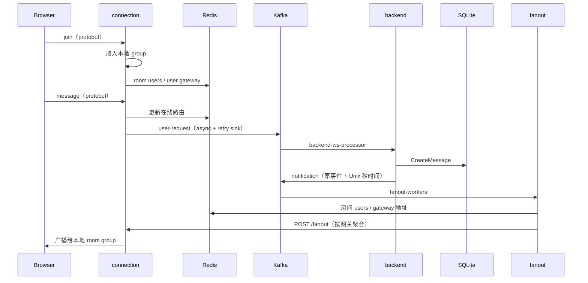

# 架构与实际数据流

## 服务边界

| 服务 | 所有权 | 启动入口 |
| --- | --- | --- |
| backend | REST、用户/session、永久成员关系、消息历史、入站 Kafka 业务处理 | [main](../backend/cmd/main.go)、[装配](../backend/internal/routes/routes.go) |
| connection | 本实例 WS、client/group、在线 presence、消息入站 sink、HTTP fanout | [main](../connection/cmd/server/main.go) |
| fanout | notification 消费、Redis 路由查找、向网关 HTTP 推送 | [main](../fanout/cmd/worker/main.go) |
| frontend | 页面、localStorage 登录状态、历史加载、optimistic pending、WS 重连 | [App](../frontend/src/App.tsx)、[ChatRoom](../frontend/src/components/chatroom/ChatRoom.tsx) |
| Python | 独立文档索引、TF-IDF 搜索、抽取回答 | [main](../python_ai_service/app/main.py) |

三个 Go module 独立管理依赖，不存在根 go.mod。Python 尚无聊天系统调用方。

## 消息发送

这是当前装配路径。join/leave 仅在网关处理，不发布 Kafka；backend 虽有 join/leave 分支，正常网关路径不会触发它们。只有 message 进入 Kafka。

[KafkaService](../backend/internal/service/kafka_service.go) 写库后仍转发原事件；写库失败也会继续发布，且没有把数据库分配的 Message.ID 回填至事件。REST `POST /api/messages` 只调用 service 写库，不发布 notification。两条路径不具备相同投递语义。

## 状态边界

| 状态 | 位置 | 生命周期与约束 |
| --- | --- | --- |
| 用户、会话、永久成员、历史消息 | backend SQLite / GORM | 自动迁移；文件默认 backend/mydb.sqlite |
| Token block cache | backend 进程内 TypedCache | 非跨实例；当前实际 REST middleware 主要走数据库 session 校验 |
| 用户聊天室缓存 | Redis，以 username 为 key | 30 分钟；与在线 room 集合不是同一数据 |
| 在线房间用户 | Redis room:{id}:users | 网关写入/刷新，默认整集合 TTL 2 分钟 |
| 用户所属网关 | Redis user:{id}:gateway | 单个地址值，默认 2 分钟 |
| 当前 WS 与 group | connection MemoryStore | 实例内；连接 ID 与业务 UserID 不同 |
| pending 消息与 UI 登录状态 | 前端内存 / localStorage | 刷新、重连与服务端状态需要应用层协调 |
| 检索文档 | Python 字典 + data/store.json | 单进程锁，本地 JSON；每次写入重建 TF-IDF |

永久成员关系不自动订阅 WS group；用户选择房间才发送 join。presence 每 30 秒从本地连接/group 刷新，断线时检查同一用户是否仍有连接再删除。单用户多网关与房间集合过期语义尚有缺口。

## 连接与可靠性

网关已有全局建连限流、每连接消息限流、1 MiB WS 读限制、ping/pong、读写 deadline、慢客户端处理和关闭 channel 保护。sink 使用 1024 队列、1 worker、3 次 Kafka 写重试；入队成功不代表落库或端到端送达。

fanout 默认依次请求各网关，单请求超时 3 秒；分发失败仍标记 Kafka 消息。没有端到端 ACK、持久补发、死信、幂等落库或 exactly-once 保证。backend/gateway 也没有完整信号驱动 draining 流程。详细问题与验收条件见 [现状](status.md)。

当前 WS 认证没有接线，/fanout 没有认证，backend 密钥硬编码；这些是当前实现状态，不能作为生产安全边界。

## 部署关系

Compose 是开发完整链路：Traefik 单入口 8000，backend/connection/fanout 使用挂载的 Linux 二进制，前端容器执行 CRA dev server。多阶段 Dockerfile/CD 仅覆盖 backend、connection。kind 仅部署两者和基础设施，缺 fanout，尚不等于完整聊天拓扑。见 [开发运行](development.md)、[部署指南](../deploy/AGENTS.md)。
